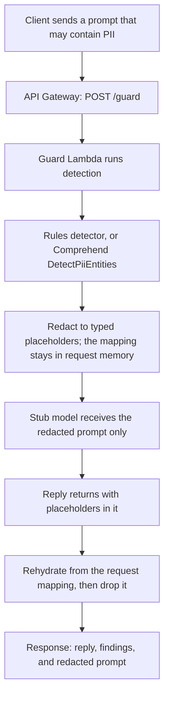

# Architecture

## The flow

A client wants to ask a model something, and the prompt contains
personal data: a card number typed into a chat box, an SSN pasted
into a support question. Sending that text to a third-party model
API means the data leaves the building, lands in someone else's
logs, and stays there. This middleware sits in front of the model so
the raw prompt never makes that trip.

The mapping between placeholders and real values exists only
between the redaction and rehydration steps, inside one
invocation's memory. It is never written to a disk, a database,
or a log.

## What this solves

The problem is where prompts end up. Text sent to a third-party
model API is processed on someone else's systems and written to
someone else's logs, and the person who typed it usually has no
idea it contained anything sensitive until much later. Deleting
it after the fact is not in the caller's control.

The fix has to happen before the prompt leaves. This middleware
is that checkpoint: scan, replace the personal data with
placeholders, and let only the redacted text travel. Because the
mapping between placeholders and real values is never stored,
there is no second copy of the data sitting inside the guardrail
either. The design protects in both directions: nothing raw goes
out, and nothing raw piles up in my own system.

## What each part does

**Guard engine** (`src/guard.py`). One interface, detect(text), two
detectors. Rules mode is deterministic: card numbers must pass a
Luhn checksum, Social Security numbers must pass the SSA validity
rules for area, group, and serial numbers, emails and US phone
numbers match patterns, and names and street addresses match simple
heuristics that only fire in narrow shapes. Comprehend mode calls
Amazon Comprehend DetectPiiEntities and maps its entity types onto
the same finding shape, so the rest of the pipeline cannot tell the
two apart. redact() swaps each finding for a typed placeholder,
[CARD_1], [SSN_1], and so on, and returns the mapping. rehydrate()
reverses it.

**Model stub** (`src/model_stub.py`). Stands in for the LLM API.
It receives only the redacted prompt, and its reply is a short
deterministic note about what it received. A real deployment swaps
this one function for an actual model call and nothing else changes,
because the stub's input is already the safe version of the text.

**Handler** (`src/handler.py`). The Lambda entry point and the same
code path the local demo runs. It takes {prompt, mode}, runs the
guard pass, gets the model reply, rehydrates the reply with the
request's mapping, and returns the redacted prompt, the findings
(types and placeholders, never values), the model reply, and the
rehydrated reply.

**SAM template** (`template.yaml`). One function, one API event,
one output. The function's role holds exactly one permission,
comprehend:DetectPiiEntities, which rules mode never uses and
comprehend mode needs. DetectPiiEntities does not support
resource-level permissions in IAM, so the resource is "*"; the
scope control here is that this single action is the only thing the
function can do in AWS at all.

## Why these services

**API Gateway, because the guard needs a proper front door.** It
gives a managed HTTPS endpoint with request validation and
throttling in front of the function, so malformed or abusive
traffic gets stopped before it reaches the guard code. The
alternative, invoking Lambda directly or through a bare function
URL, leaves traffic shaping to me and couples every client to
the function's own address and auth shape.

**Lambda, because one request should leave nothing behind.** The
central rule of this design is that the placeholder mapping
exists only inside a single request. A Lambda invocation fits
that rule naturally: it starts, handles the request, and its
memory goes away. A long-running server could keep the same
discipline in code, but process memory that lives for weeks is
exactly where a mapping could linger by accident, in a cache, a
global variable, or a debug dump. Short-lived invocations make
the safe behavior the default behavior. The trade-off is cold
starts and per-request overhead, which a guardrail in front of a
model call can afford, because the model call itself is slower.

**Amazon Comprehend, because rules cannot see names.** My rules
detector is strong on structured data: cards have checksums and
SSNs have validity rules. Names and free-form addresses have
neither, and my heuristics only catch them in narrow shapes.
DetectPiiEntities is a managed model trained to find exactly
those entities, so it is the second mode rather than a bigger
pile of regex. The trade-offs are honest ones. In comprehend
mode the raw prompt is sent to another AWS service for analysis:
inside the account's boundary, but still a second system seeing
the data. It costs per request where rules mode costs nothing.
And its findings come with confidence scores, so a threshold has
to be chosen, and any threshold both misses borderline entities
and flags some harmless ones.

**A stub model, because the project is about the guard.** A real
model call would add API keys, cost, and output that changes
from run to run, and would prove nothing about the redaction.
The stub receives only redacted text and answers
deterministically, which keeps the demo and the tests stable.
Any real model slots in behind the same call, because by that
point in the flow the text it receives is already the safe
version.

## Decisions

**Raw prompts are never stored.** The mapping between placeholders
and real values exists in one request's memory and is dropped when
the handler returns. There is no database, no bucket, and no log
statement in this project that writes a prompt or a mapping. The
reason is simple: a store of mappings is a store of PII with extra
steps. The cost of the decision is real too. Nothing can be audited
or replayed after the fact, and a caller who loses the response
cannot recover the mapping. For a guardrail whose whole job is
keeping personal data out of other systems, that trade is the right
way round.

**Two detectors behind one interface.** Rules mode runs anywhere,
costs nothing, and behaves identically every run, which is what
makes the local demo and the tests meaningful. Its limits are plain:
patterns cannot judge context, and names or free-form addresses slip
past heuristics. Comprehend mode is the deployed answer to those
limits, a managed model trained for exactly this. Keeping both
behind detect(text) means the comparison between them is a config
value, not a rewrite.

**Typed placeholders instead of masks.** Replacing a card with
[CARD_1] rather than asterisks keeps the prompt readable for the
model, keeps the reply rehydratable, and keeps two different cards
in one prompt distinguishable. A mask destroys all three.

**Python standard library only, locally.** The engine, handler, demo,
and tests need no installs. boto3 appears only inside the Comprehend
detector, imported lazily, because on AWS it ships with the Lambda
runtime and everywhere else its absence is the honest signal that
comprehend mode cannot run there.
