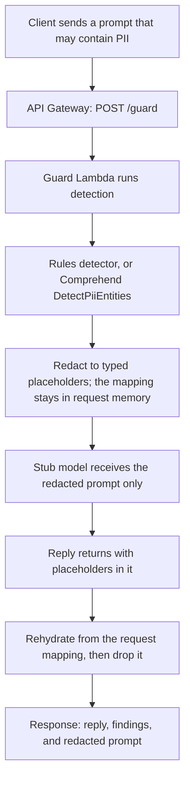

# LLM PII Guardrail

## Story

People paste personal data into AI chat boxes every day. A card
number goes into a support chat. An SSN goes into a benefits
question. The moment that text is sent to a model API, it sits in a
third party's request logs, and the person who typed it has no say
in how long it stays there.

This project is the middleware that sits in front of the model so
the raw prompt never makes that trip. A client sends a prompt, the
guardrail scans it for personal data, swaps what it finds for typed
placeholders like [CARD_1] and [EMAIL_1], and only the redacted
version goes any further. The placeholder mapping stays in the
request's memory, so the model's reply can be rehydrated locally
for the caller, and then the mapping is gone. Nothing is stored.

It is one stage of a wider AI security roadmap I am working through:
privacy and cryptographic guardrails for LLM APIs, built as a small
service with a local rules engine, an AWS deployment shape, and a
test suite that pins down exactly what it catches and what it
misses.

## How it works

Four steps, each a separate piece:

1. **Detect.** The prompt is scanned for card numbers, Social
   Security numbers, emails, phone numbers, names, and street
   addresses. Card numbers must pass a Luhn checksum before they
   count. SSNs must pass the SSA validity rules. Names and
   addresses come from simple heuristics and are the weak part of
   the system, on purpose and in the open.
2. **Redact.** Each finding is replaced with a typed placeholder,
   numbered per type: [CARD_1], [SSN_1], [EMAIL_1]. The same value
   always gets the same placeholder within a request, so a repeated
   email stays one placeholder.
3. **Forward.** Only the redacted prompt reaches the model. In this
   repo the model is a deterministic stub, not a real LLM call, so
   the whole flow can run and be tested with no API keys and no
   network.
4. **Rehydrate.** The model's reply comes back with placeholders in
   it. The handler resolves them against the request's mapping and
   returns a normal answer to the caller, along with the redacted
   prompt and the list of findings (types and placeholders, never
   the values).

The same flow as a diagram:



Detection runs in two modes behind one interface. **Rules mode** is
deterministic and local: patterns and checksums, same input, same
output, every time. **Comprehend mode** calls Amazon Comprehend
DetectPiiEntities and maps its entity types onto the same finding
shape. It runs only in the deployed Lambda, where boto3 and the
scoped IAM permission exist. No local result in this repo comes
from Comprehend, and the demo below is rules mode only.

Full detail, including the diagram and the reasoning on storage, is
in [ARCHITECTURE.md](ARCHITECTURE.md).

### Decisions

- **The mapping is never stored.** No database, no bucket, no log
  line holds a raw prompt or a mapping. A stored mapping is stored
  PII with extra steps. The cost is that nothing can be audited or
  replayed later, and ARCHITECTURE.md says why that trade is worth
  it here.
- **Typed placeholders instead of masks.** [CARD_1] keeps the
  prompt readable for a model, keeps two different cards in one
  prompt distinguishable, and makes rehydration possible. Asterisks
  do none of that.
- **One Lambda, one permission.** The SAM template deploys a single
  function behind API Gateway (POST /guard). Its role holds exactly
  one action, comprehend:DetectPiiEntities. DetectPiiEntities does
  not support resource-level IAM permissions, so the resource is
  "*"; the scope control is that this one action is all the
  function can do in AWS.
- **A stub model, honestly labeled.** The point of the project is
  the guardrail, not the model behind it. The stub is deterministic,
  which keeps the demo output stable enough to print in this file
  and check against.
- **Python standard library only for everything local.** The
  engine, handler, demo, and tests need no installs. boto3 is
  imported lazily inside the Comprehend detector only, because its
  absence outside AWS is the honest signal that the mode cannot run
  there.

## Output

Run the local demo. It sends all eight sample prompts through the
same handler code the Lambda runs:

```bash
python3 run_demo.py
```

Real output from that run:

```
Running 8 sample prompts through the guardrail (rules mode)...

--- 001-card-and-email.txt
Findings: CARD -> [CARD_1], EMAIL -> [EMAIL_1]
Redacted prompt: Please update the payment method on my account. My new card number is [CARD_1] and it expires next March. Send the confirmation to [EMAIL_1] when it is done.
Model reply: Stub model reply: I received a 28-word prompt. I can see redacted values in it ([CARD_1], [EMAIL_1]), so I will answer without the personal details. Here is a draft answer based only on the redacted text.

--- 002-ssn-and-phone.txt
Findings: SSN -> [SSN_1], PHONE -> [PHONE_1]
Redacted prompt: I am filling in the benefits form and it asks for my Social Security number, which is [SSN_1]. If anything is missing, call me at [PHONE_1] after 6 pm.
Model reply: Stub model reply: I received a 29-word prompt. I can see redacted values in it ([SSN_1], [PHONE_1]), so I will answer without the personal details. Here is a draft answer based only on the redacted text.

--- 003-name-and-address.txt
Findings: NAME -> [NAME_1], ADDRESS -> [ADDRESS_1]
Redacted prompt: Hi, my name is [NAME_1] and I just moved. Please ship the replacement unit to [ADDRESS_1] and update the address on my account.
Model reply: Stub model reply: I received a 23-word prompt. I can see redacted values in it ([NAME_1], [ADDRESS_1]), so I will answer without the personal details. Here is a draft answer based only on the redacted text.

--- 004-near-misses.txt
Findings: none
Redacted prompt: My order number is 4111 1111 1111 1112 and I placed it on 2026-11-23. Also, can you explain why everyone compares this phone launch to the one Steve Jobs announced in 2007?
Model reply: Stub model reply: I received a 32-word prompt. It contains no redacted values. Here is a draft answer based only on the redacted text.

--- 005-clean-question.txt
Findings: none
Redacted prompt: Explain the difference between TCP and UDP to a junior engineer, with one example of when each is the better choice.
Model reply: Stub model reply: I received a 21-word prompt. It contains no redacted values. Here is a draft answer based only on the redacted text.

--- 006-clean-coding.txt
Findings: none
Redacted prompt: Write a Python function that takes a list of integers and returns a new list with the duplicates removed, keeping the original order.
Model reply: Stub model reply: I received a 23-word prompt. It contains no redacted values. Here is a draft answer based only on the redacted text.

--- 007-repeat-values.txt
Findings: EMAIL -> [EMAIL_1], EMAIL -> [EMAIL_1], PHONE -> [PHONE_1]
Redacted prompt: Email the invoice to [EMAIL_1], and copy [EMAIL_1] on the receipt as well. My phone is [PHONE_1] if the delivery driver needs me.
Model reply: Stub model reply: I received a 23-word prompt. I can see redacted values in it ([EMAIL_1], [PHONE_1]), so I will answer without the personal details. Here is a draft answer based only on the redacted text.

--- 008-invalid-ssn.txt
Findings: none
Redacted prompt: The form rejected my ID number 900-12-3456 and my backup number 000-45-6789. Can you tell me what format it expects instead?
Model reply: Stub model reply: I received a 21-word prompt. It contains no redacted values. Here is a draft answer based only on the redacted text.

Demo complete.
```

Two of those results are the point of the sample set. In 004, the
order number has the exact shape of a card number and one digit
different from the real test card in 001; the Luhn checksum fails,
so it is left alone, and the date and the public figure's name pass
through untouched as well. In 008, both ID numbers have the SSN
shape and both break the validity rules (area 900 and area 000), so
neither is flagged.

The sample prompts are fictional. The card number is a published
payment-industry test number, the SSN is the standard textbook
example, the phone numbers use the reserved 555 range, and the
emails sit on example.com.

Tests, run with the standard library test runner:

```bash
python3 -m unittest discover -s tests
```

Result: 22 tests, all passing. They cover detection per type, the
Luhn rejection of the near-miss card, SSN validity rules, the name
heuristic needing a trigger phrase, placeholder consistency for a
repeated value, the rehydration round trip, clean prompts passing
through unchanged, the Comprehend type mapping through an injected
fake client, and the Lambda handler's request and error handling.

The SAM template can be checked locally:

```bash
python3 validate_template.py
```

That script parses `template.yaml` with PyYAML and asserts the
structure: exactly one resource (the guard function), Python 3.12,
the POST /guard event, an IAM action list of exactly
comprehend:DetectPiiEntities, and the ApiUrl output. It passed.
What it cannot do is run the SAM transform or deploy anything, so
it cannot rule out transform errors or dependency cycles. The
template is kept to one function, one event, and one permission
partly to shrink that risk, but only a real deployment settles it,
and that has not happened yet for this project.

## Deploying to AWS

Not yet done. When it happens, the shape is the same two commands
the sibling projects used, from CloudShell:

```bash
aws cloudformation package --template-file template.yaml \
  --s3-bucket <artifacts-bucket> --output-template-file packaged.yaml
aws cloudformation deploy --template-file packaged.yaml \
  --stack-name llm-pii-guardrail --capabilities CAPABILITY_IAM
```

Then POST a JSON body like {"prompt": "...", "mode": "rules"} to
<API URL>/guard. Comprehend mode is exercised only after this
deployment, since that is the first place its permission exists.

## Worth

What this project shows, in practical terms:

- A privacy control placed where it belongs in an LLM system: in
  front of the model, before data leaves, not as a cleanup step
  after.
- Detection that mixes checksums and validity rules with patterns,
  and knows the difference. A card-shaped string is not a card
  until the checksum says so.
- A two-mode design where the local deterministic engine and the
  managed AWS service share one interface, so the deployed upgrade
  is a mode switch rather than a rewrite.
- Least privilege written down to a single IAM action, and a design
  that stores nothing at all, which is the smallest possible data
  protection surface.

Honest limits:

- **Verified locally in rules mode only.** The demo, the tests, and
  the template check above are all local runs. Comprehend mode is
  code plus a fake-client test of its type mapping; it has never
  called the real service. Live AWS deployment is the next step,
  not a done thing, and the deployed upgrade path may still surface
  template problems the local check cannot see.
- **Rules miss names and free-form addresses.** The name heuristic
  needs a trigger phrase like "my name is", and the address
  heuristic needs a number, a street name, and a known suffix. A
  name dropped mid-sentence or an address written loosely goes
  through. That gap is the main reason comprehend mode exists in
  the design.
- **Regex cannot judge context.** The engine cannot tell a real
  card number from a test one, or a person's own phone number from
  a business's public one. It redacts all of them, which is the
  safe direction, but it is still a blunt instrument.
- **A determined user can encode PII past the patterns.** Numbers
  spelled out in words, digits split across lines, or values hidden
  in an image will not be caught by this engine. A guardrail like
  this reduces exposure; it does not end it.
- **The model behind the guardrail is a stub.** No real LLM is
  called anywhere in this repo, so nothing here measures how a real
  model handles redacted prompts.

## Layout

```
src/            guard.py, handler.py, model_stub.py
sample-data/    eight fictional prompts, including near-misses
tests/          unittest suite for the engine and the handler
template.yaml   AWS SAM template, one Lambda behind API Gateway
run_demo.py     the local end to end run
validate_template.py   structural check of the SAM template
ARCHITECTURE.md flow, components, and decisions in full
```

## License

MIT. See `LICENSE`.
